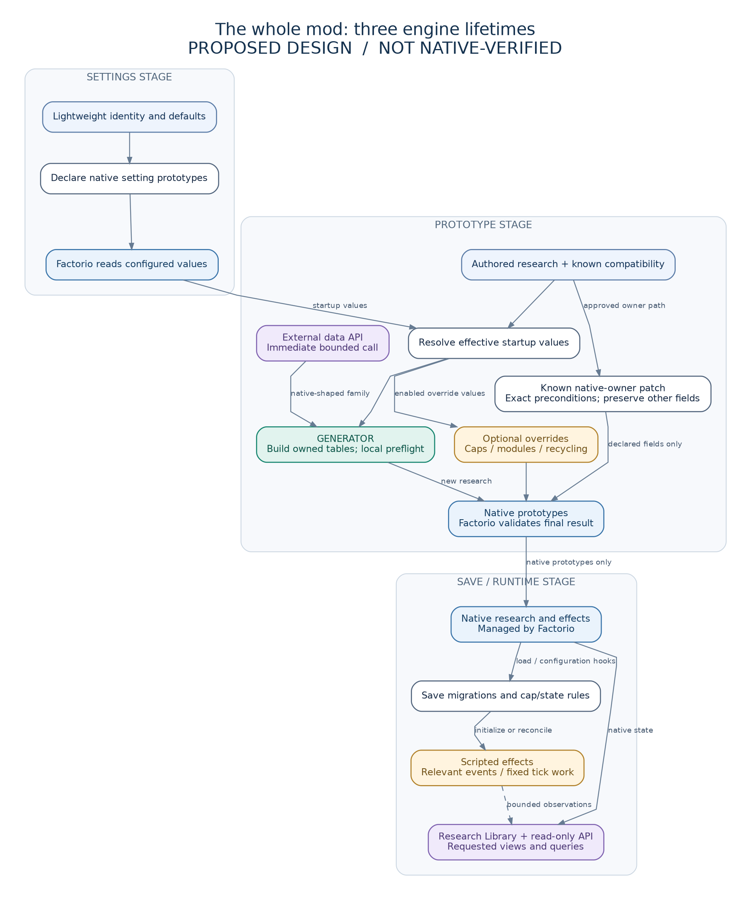

# How MIR fits together

## Follow the product flow

Settings select the effective configuration and integrations. Authored research modules construct native technology tables. The Generator validates and publishes those tables. Factorio then owns ordinary research and its native effects; MIR's runtime handles caps, earned-credit reconciliation, repair, agriculture, spoilage and the Research Library.

Start with the [source map](#where-to-change-a-feature) to find a feature. The [offline visual atlas](diagrams/index.html) offers additional lifecycle diagrams with editable Mermaid source, SVG and PNG. Exact Factorio observations and remaining qualification are recorded in [progress](progress.md).

`research/generator.lua` receives already-built technology tables through `install(prototypes, data_stage)`. It does not resolve player settings, choose integrations or construct their research effects and formulas.

There is no always-running Generator, no intelligent discovery engine and no cross-stage Lua object that secretly connects everything.

## 1. Settings stage: define the controls

`settings.lua` and any genuinely needed settings-stage rounds declare the existing controls. A lightweight catalogue supplies stable setting identities and defaults. It must not import the Generator, inspect a non-existent factory or resolve arbitrary recipe chains.

Factorio then loads configured values. Keep declaration, raw value and effective value distinct. A profile import may affect the effective value; MIR preserves the actual inherited precedence rather than assuming raw `settings.startup` is the complete answer. Runtime-global and per-user settings retain their own lifetimes. See diagram 04 and [settings contract](../spec/settings.md).

## 2. Prototype stage: build the native mod

All mods run `data.lua`, then all run `data-updates.lua`, then all run `data-final-fixes.lua`, in the engine's mod order. MIR does not own the final position. A supported integration declares the phase/dependency assumptions it actually needs. This ordering is why an external API call publishes immediately rather than registering work for a finalizer that may have already finished. See diagrams 02 and 06.

For each applicable authored family:

1. Check cheap activation conditions, then load that integration body only when needed.
2. Resolve the relevant effective settings and approved compatibility variant.
3. Bind exact recipes/prerequisites/science, or use one explicitly justified shared collector for existing broad behavior.
4. Construct fresh native technology tables; preserve established names and cost/effect semantics.
5. Preflight the finite family against its own name map and current relevant prototypes.
6. Publish new prototypes once. An existing-owner modification follows a separately specified narrow patch, not duplicate-tolerant creation.

The Generator does not invent a technology or decide gameplay balance. Those decisions exist in reviewed declarations and tests. A recipe's presence is not a global proof of researchability, economics or compatibility.

## 3. A worked path, with illustrative numbers

This example is **not** the recovered MIR 4.7 gear contract and is not suitable for migrating a player's save.

Assume an authored example supplies one exact recipe, one exact prerequisite, one science vector, a native per-level productivity change of `0.01`, and `100 * 2^(L-1)` with a first level of 1. The research construction code resolves the selected settings and binding, then builds the native table with those identities, effects and formula. The Generator checks the submitted tables and references before publishing. The engine evaluates the next research cost; MIR does not enumerate infinite levels.

Under that illustrative formula the costs at L=1 and L=2 are 100 and 200. A different published MIR family may have a different level offset, growth rule, native owner or scalar. Recover and test that contract rather than imposing this example universally.

After research completes, Factorio applies the native effect. MIR does not wake up every tick to maintain it. Scripted spoilage, growth, repair or caps have separate event/state contracts and must retain their actual behavior.

## 4. Missing, disabled and historical are different

Diagram 03 intentionally does **not** say "disabled → delete technology".

A new optional feature whose upstream content is absent can remain inactive. A released identity needed for save continuity must follow its existing disable/preservation policy. The data stage cannot inspect a particular save to ask whether it was researched. If there is no accepted preservation policy, the upgrade claim is blocked—not silently treated as supported.

Malformed explicit definitions and duplicate ownership are errors, caught before release qualification. A broad `pcall` that hides partial writes is not graceful compatibility. Local preflight is also not an engine-wide transaction that rolls back arbitrary other mods.

## 5. Overrides are independent

Productivity ceilings, module permissions and recycler changes can require visiting many prototypes. That is explicit work for an enabled feature, not research discovery. Engine-default settings return before enumeration. Do not remove useful broad behavior just to claim that no scan exists.

An approved collector may add targets to an already-authored family. It cannot invent new family IDs, science or prerequisites. Diagram 12 separates this cost from the exact-binding Generator.

## 6. Cross-stage data: most Lua does not survive

The engine retains recognized prototype information, but discards startup Lua state. A table returned by `require`, a Generator registry or a data-stage closure is not runtime storage.

Runtime obtains research from native force technologies, configuration from accepted setting rules, presentation from compact authored metadata, and required mutable state from explicitly owned persistent fields. An engine-supported metadata transport is optional and must have a real consumer. Diagram 05 shows this boundary.

## 7. Runtime: native first; necessary Lua only

`control.lua` imports modules and registers handlers while being parsed. Relevant native save hooks initialize, migrate or reconnect state. `on_load` must not write saved state or use unavailable `game`; joining clients reconstruct handlers without rerunning the host's migrations. Diagram 07 shows the different branches.

Native effects add no recurring MIR Lua loop. A repair feature may legitimately need periodic work: use ticks and declared work counts, preserve rate/fairness and test backlog behavior. Do not decide gameplay by the local wall clock. Turning off a previously active feature may require one cleanup/restoration before becoming idle.

The Library reads native state and needed metadata. It builds requested views and handles per-player presentation without recreating the former compiler. Translations and display order cannot select force-wide research semantics.

## 8. One API, two engine lifetimes

The data interface lives at `__more-infinite-research__.api.v1.data`; the runtime remote interface is `more-infinite-research.api.v1`. `v1` is an API-major boundary, independent of the MIR product version.

A data caller can create a native technology or finite family through the thin helper. Native `data:extend` remains valid. A runtime consumer queries bounded native state in a game-available callback and owns its own effect handlers/storage. It cannot create technology prototypes at runtime. The SDK is optional examples/annotations/conformance, never a player dependency.

The [API guide](api.md) describes the frozen API 1.0 modern subset and its independently tested consumers. Its recorded scope does not establish support on every engine or complete stable acceptance of MIR.

## 9. Determinism is an input contract

Diagram 09 identifies build, Generator, runtime and migration inputs separately. Factorio already makes several Lua operations deterministic; this does not make arbitrary insertion histories or mod orders semantically equivalent. MIR uses explicit sequence, ownership and conflict rules.

Equal complete inputs must give equal semantic output. Elapsed startup time and peak RAM still vary. A deterministic wrong effect is still a bug. Read the focused [determinism contract](../spec/determinism.md) for the exact guarantees.

## 10. The development loop remains outside the game

Specs constrain source; tests compare against independent expected behavior; tools build packages and retain exact results. Diagram 10 shows cheap affected checks before expensive native, save, client and performance qualification. Diagram 11 shows that none of those tools or diagrams ships inside the player ZIP.

History supplies obligations and regression evidence, not an excuse to retain the former compiler. AIDE remains optional assistance. No model agreement, line-count target or archive checksum replaces native proof.

## Implementation and qualification

The [player source](../source/README.md) implements the Generator, authored modern and historical catalogues, compatibility bindings, settings, runtime effects, migrations, Library and API. The [continuity inventory](../spec/inventory/continuity.json) records retained obligations and remaining qualification. Exact native catalogue, lab, save and client observations are linked from [progress](progress.md); earlier receipts retain their original source identities. The diagrams describe responsibilities, while final-source, performance, layout and publication acceptance remain separate work.

## Where to change a feature

These are the current paths. Entrypoints compose feature modules; feature modules use small helpers and engine adapters. Runtime code must not import modules that require the prototype-stage `data` object.

| Responsibility | Current implementation |
|---|---|
| Declare settings and resolve imported/effective values | [settings entrypoint](../source/settings.lua), [research/settings.lua](../source/research/settings.lua), [research/settings_profile.lua](../source/research/settings_profile.lua); [runtime/configuration.lua](../source/runtime/configuration.lua) resolves the shared runtime values at control parsing |
| Select integrations and compose technology output | [data-final-fixes.lua](../source/data-final-fixes.lua), [compatibility/modern_catalogue.lua](../source/compatibility/modern_catalogue.lua) and the relevant `compatibility/` binding |
| Change the named RIC Marine carbonisation route | [integrations/ric/profile.lua](../source/integrations/ric/profile.lua) for shared identity/activation, [integrations/ric/research.lua](../source/integrations/ric/research.lua) for its binding and native construction |
| Check selected RIC or Bob material process returns | [compatibility/material_returns.lua](../source/compatibility/material_returns.lua) for the shared typed proof; the data-stage entrypoint owns its lazy ingredient index |
| Build research tables, costs and science | [research/modern.lua](../source/research/modern.lua), authored definitions in `research/` and `compatibility/`, [research/cost.lua](../source/research/cost.lua), [research/science.lua](../source/research/science.lua) |
| Validate and publish the finite submitted technology set | [research/generator.lua](../source/research/generator.lua) |
| Change existing prototype fields explicitly | `overrides/`, for example [pipeline_extent.lua](../source/overrides/pipeline_extent.lua); these operations have their own activation and preflight boundaries |
| Register runtime handlers and compose lifecycle operations | [control.lua](../source/control.lua), [runtime/bootstrap.lua](../source/runtime/bootstrap.lua) |
| Apply cap policy and preserve its disablement rights | [runtime/lifecycle.lua](../source/runtime/lifecycle.lua), [runtime/caps.lua](../source/runtime/caps.lua), [runtime/cap_admission.lua](../source/runtime/cap_admission.lua) |
| Preserve earned contributions across ownership changes | [runtime/native_credits.lua](../source/runtime/native_credits.lua), [runtime/native_gun_credits.lua](../source/runtime/native_gun_credits.lua) and their authored `research/` contracts |
| Run repair, agriculture and spoilage | [runtime/passive_repair.lua](../source/runtime/passive_repair.lua), [runtime/scripted_effects.lua](../source/runtime/scripted_effects.lua), [runtime/agriculture.lua](../source/runtime/agriculture.lua), [runtime/spoilage.lua](../source/runtime/spoilage.lua) |
| Change Library rendering, input or personal state | [runtime/library.lua](../source/runtime/library.lua), `runtime/library_translations.lua`, `runtime/library_production.lua`, and the `presentation/library_*` modules |
| Query shared research metadata | [runtime/catalogue.lua](../source/runtime/catalogue.lua); the Library reads this state rather than owning force research |
| Adapt engine capabilities or extend the public API | [platform/target.lua](../source/platform/target.lua), [api/v1/data.lua](../source/api/v1/data.lua), [api/v1/runtime.lua](../source/api/v1/runtime.lua) |

Some implementation is still split across directories. The move map below describes the first bounded reorganisation; it does not describe paths that already exist.

## Data and saved-state owners

Factorio owns raw settings, technology prototypes, force research, progress, queues and native bonuses. Startup Lua tables and module-local caches are not a persistent MIR database. Persistent MIR bookkeeping uses `storage` on modern engines; historical adapters use the engine's earlier `global` facility.

| Saved key | Owning module | Schema | Created or updated by |
|---|---|---|---|
| `storage.mir_library` | `runtime/library.lua` | 1, including a versioned translation ledger | Library open and relevant player/GUI callbacks; configuration imports the applicable legacy `storage.mir.research_browser` view |
| `storage.mir_caps` | `runtime/lifecycle.lua` | 1 | Cap reconciliation when bookkeeping is needed; configuration imports admitted legacy `storage.mir.maximum_level_control` rights |
| `storage.mir_native_credits` | `runtime/native_credits.lua` | 1 | Init/configuration and affected research/force callbacks; retains per-force earned recipe history |
| `storage.mir_native_gun_credits` | `runtime/native_gun_credits.lua` | 1 | Init/configuration and affected research/force callbacks; retains the authored electric/Tesla contribution masks and holder counts |
| `storage.mir_competing_productivity` | `runtime/competing_productivity.lua` | 1 | Applicable suppression reconciliation; removed when its owned-disablement records become empty |
| `storage.mir_k2_imersite_state` | `runtime/bootstrap.lua` with `runtime/k2_imersite_migration.lua` | 1 | Selected K2SO lifecycle reconciliation; imports the retained historical staged-migration record |
| `storage.mir.passive_repair` | `runtime/bootstrap.lua` with `runtime/passive_repair.lua` | Historical, unversioned | Repair lifecycle and scheduled work when the feature needs state |
| `storage.mir.agricultural_growth_speed` and `storage.mir.spoilage_preservation` | `runtime/scripted_effects.lua` | Historical, unversioned | Named lifecycle/research/force callbacks; calculation modules receive these buckets explicitly |

These are the main saved bookkeeping keys; historical migration readers retain additional original fields. Init/configuration and the named event handlers may change their owned state. Load callbacks reconnect subscriptions and caches without writing saved state. Moving a Lua file must preserve these keys, schema readers and published migration filenames.

## First source move: keep the Library together

The destination is `source/ui/library/`. Keep the current GUI/input/personal-state owner intact for the mechanical move; splitting it is a separate decision based on responsibility and actual use.

| Current file under `source/` | Destination under `source/` |
|---|---|
| `runtime/library.lua` | `ui/library/browser.lua` |
| `runtime/library_translations.lua` | `ui/library/translations.lua` |
| `runtime/library_production.lua` | `ui/library/production.lua` |
| `presentation/library_model.lua` | `ui/library/model.lua` |
| `presentation/library_layout.lua` | `ui/library/layout.lua` |
| `presentation/library_localization.lua` | `ui/library/localization.lua` |

Keep `runtime/catalogue.lua`, cap/credit ownership, `presentation/availability.lua`, `presentation/shortcut.lua`, public API paths and `platform/` in their current roles in this first move. Decide shared helper placement from its consumers rather than pulling gameplay state into the UI directory. Later integration moves should group each ecosystem's definitions and adaptation under `integrations/`, one ecosystem at a time; do not create a second competing integration tree.

Before moving these files, coordinate ownership with the current writer. Update `runtime/bootstrap.lua`, imports among the six modules, and live test/tool path references in the same mechanical commit. Historical executed scripts and receipts retain their original paths and source refs. Compare package members using the explicit old-to-new map, check case-sensitive import resolution, run the affected Library/model/translation/Discovery Tree controls and inspect generated research for unintended changes. The integration owner then runs the affected packaged Library lifecycle/input check. File moves change ZIP members and bytes; they do not consume a release version until publication or require replaying unrelated historical routes.

The remaining acceptance work continues against its fixed packages while this separate change is reviewed. There is no repository-wide reorganisation prerequisite for stable.
