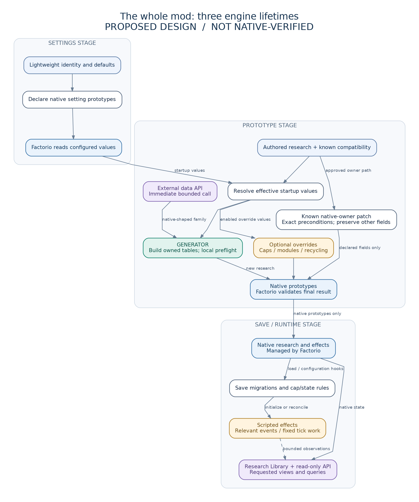

# How MIR fits together

## Start with the picture, not the folders

Open the [offline visual atlas](diagrams/index.html). It contains twelve permanent architecture diagrams, each with editable Mermaid source, SVG and PNG. The temporary repository cutover has its own transition diagram in the cutover guide. The pictures describe the proposal, not an executed Factorio trace.

**The shortest correct model:** configuration selects authored research; the Generator creates native prototypes during loading; Factorio runs ordinary research; MIR runtime code handles only the remaining explicit features.

There is no always-running Generator, no intelligent discovery engine and no cross-stage Lua object that secretly connects everything.

## 1. Settings stage: define the controls

`settings.lua` and any genuinely needed settings-stage rounds declare the existing controls. A lightweight catalogue supplies stable setting identities and defaults. It must not import the Generator, inspect a non-existent factory or resolve arbitrary recipe chains.

Factorio then loads configured values. Keep declaration, raw value and effective value distinct. A profile import may affect the effective value; MIR preserves the actual inherited precedence rather than assuming raw `settings.startup` is the complete answer. Runtime-global and per-user settings retain their own lifetimes. See diagram 04 and [settings contract](../../spec/mir5/settings.md).

## 2. Prototype stage: build the native mod

All mods run `data.lua`, then all run `data-updates.lua`, then all run `data-final-fixes.lua`, in the engine's mod order. MIR does not own the final position. A supported integration declares the phase/dependency assumptions it actually needs. This ordering is why an external API call publishes immediately rather than registering work for a finalizer that may have already finished. See diagrams 02 and 06.

For each applicable authored family:

1. Check cheap activation conditions, then load that integration body only when needed.
2. Resolve the relevant effective settings and approved compatibility variant.
3. Bind exact recipes/prerequisites/science, or use one explicitly justified shared collector for existing broad behavior.
4. Construct fresh native technology tables; preserve established names and cost/effect semantics.
5. Preflight the finite family against its own name map and current relevant prototypes.
6. Publish new prototypes once. An existing-owner modification follows a separately specified narrow patch, not duplicate-tolerant creation.

The Generator does not invent a technology or decide gameplay balance. Those decisions exist in reviewed declarations and tests. A recipe's presence is not a global proof of researchability, economics or compatibility.

## 3. A worked path, with illustrative numbers

This example is **not** the recovered MIR 4.7 gear contract and is not suitable for migrating a player's save.

Assume an authored example supplies one exact recipe, one exact prerequisite, one science vector, a native per-level productivity change of `0.01`, and `100 * 2^(L-1)` with a first level of 1. The Generator resolves the settings, preserves those identities, constructs that effect and formula, checks references and publishes the technology. The engine evaluates the next research cost; the Generator does not enumerate infinite levels.

Under that illustrative formula the costs at L=1 and L=2 are 100 and 200. A different published MIR family may have a different level offset, growth rule, native owner or scalar. Recover and test that contract rather than imposing this example universally.

After research completes, Factorio applies the native effect. MIR does not wake up every tick to maintain it. Scripted spoilage, growth, repair or caps have separate event/state contracts and must retain their actual behavior.

## 4. Missing, disabled and historical are different

Diagram 03 intentionally does **not** say "disabled → delete technology".

A new optional feature whose upstream content is absent can remain inactive. A released identity needed for save continuity must follow its existing disable/preservation policy. The data stage cannot inspect a particular save to ask whether it was researched. If there is no accepted preservation policy, the upgrade claim is blocked—not silently treated as supported.

Malformed explicit definitions and duplicate ownership are errors, caught before release qualification. A broad `pcall` that hides partial writes is not graceful compatibility. Local preflight is also not an engine-wide transaction that rolls back arbitrary other mods.

## 5. Overrides are independent

Productivity ceilings, module permissions and recycler changes can require visiting many prototypes. That is explicit work for an enabled feature, not research discovery. Engine-default settings return before enumeration. Do not remove useful broad behavior just to claim that no scan exists.

An approved collector may add targets to an already-authored family. It cannot invent new family IDs, science or prerequisites. Diagram 12 separates this cost from the exact-binding Generator.

## 6. Cross-stage data: most Lua does not survive

The engine retains recognized prototype information, but discards startup Lua state. A table returned by `require`, a Generator registry or a data-stage closure is not runtime storage.

Runtime obtains research from native force technologies, configuration from accepted setting rules, presentation from compact authored metadata, and required mutable state from explicitly owned persistent fields. An engine-supported metadata transport is optional and must have a real consumer. Diagram 05 shows this boundary.

## 7. Runtime: native first; necessary Lua only

`control.lua` imports modules and registers handlers while being parsed. Relevant native save hooks initialize, migrate or reconnect state. `on_load` must not write saved state or use unavailable `game`; joining clients reconstruct handlers without rerunning the host's migrations. Diagram 07 shows the different branches.

Native effects add no recurring MIR Lua loop. A repair feature may legitimately need periodic work: use ticks and declared work counts, preserve rate/fairness and test backlog behavior. Do not decide gameplay by the local wall clock. Turning off a previously active feature may require one cleanup/restoration before becoming idle.

The Library reads native state and needed metadata. It builds requested views and handles per-player presentation without recreating the former compiler. Translations and display order cannot select force-wide research semantics.

## 8. One API, two engine lifetimes

The draft data interface lives at `__more-infinite-research__.api.v1.data`; the draft runtime remote interface is `more-infinite-research.api.v1`. `v1` is an API-major boundary, not another product-major tree.

A data caller can create a native technology or finite family through the thin helper. Native `data:extend` remains valid. A runtime consumer queries bounded native state in a game-available callback and owns its own effect handlers/storage. It cannot create technology prototypes at runtime. The SDK is optional examples/annotations/conformance, never a player dependency.

API maturity remains draft until independent consumers work. Neither a metadata table nor a version string establishes useful mod compatibility. See [API guide](api.md).

## 9. Determinism is an input contract

Diagram 09 identifies build, Generator, runtime and migration inputs separately. Factorio already makes several Lua operations deterministic; this does not make arbitrary insertion histories or mod orders semantically equivalent. MIR uses explicit sequence, ownership and conflict rules.

Equal complete inputs must give equal semantic output. Elapsed startup time and peak RAM still vary. A deterministic wrong effect is still a bug. Read the focused [determinism contract](../../spec/mir5/determinism.md) for the exact guarantees.

## 10. The development loop remains outside the game

Specs constrain source; tests compare against independent expected behavior; tools build packages and retain exact results. Diagram 10 shows cheap affected checks before expensive native, save, client and performance qualification. Diagram 11 shows that none of those tools or diagrams ships inside the player ZIP.

History supplies obligations and regression evidence, not an excuse to retain the former compiler. AIDE remains optional assistance. No model agreement, line-count target or archive checksum replaces native proof.

## What is ready now?

The architectural contract and diagrams are supplied. The Generator, API, full continuity inventory and target-native validation are **not implemented or executed by this pack**. Start with one recovered historical contract in a disposable fixture, then exercise a difficult continuation/cap/runtime case and an independent API consumer before mass-porting.
