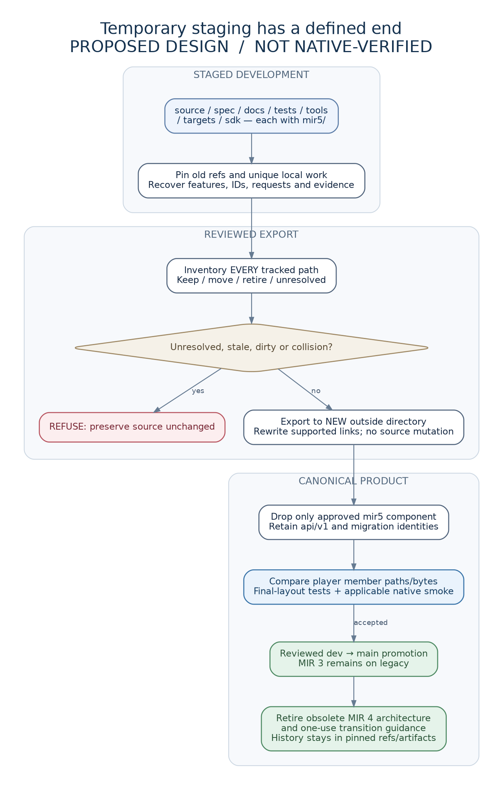

# Staging, adoption and mechanical cutover

This page and its helper are temporary transition material. They are retired from the canonical exported tree. There will not be permanent `mir5/` roots, a new `mir6/` scaffold, an active `mir4/` archive or a second implementation selector.

## 1. Adopt the additive specification

The archive adds only new staged paths and `MIR5-PACK.md`. It does not overwrite `AGENTS.md`, README, source or historical evidence. If any target path already exists, compare and reconcile it first.

Run pack checks and the supplied unit tests. The root patch is a minimal routing addition, not a wholesale deletion of existing constraints. Verify the two preimage blob IDs with the provided root checker, then `git apply --check` and inspect the patch. New local edits require a re-reviewed patch; do not force an old one.

```sh
python tools/mir5/check_pack.py
python -m unittest discover -s tests/mir5 -p 'test_*.py' -v
python tools/mir5/adoption/check_roots.py --repo .
git apply --check tools/mir5/adoption/root-routing.patch
```

After approval, applying the patch is a normal local development change. Commit reviewed pack adoption through the existing workflow. Native Factorio qualification is not performed by these commands.

## 2. One staging component per selected root

| Staged root | Canonical root |
|---|---|
| `source/mir5/` | `source/` |
| `spec/mir5/` | `spec/` |
| `docs/mir5/` | `docs/` |
| `tests/mir5/` | `tests/` |
| `tools/mir5/` | `tools/` |
| `sdk/mir5/` | `sdk/` |
| `targets/mir5/` | `targets/` |

Only create the roots needed. This archive does not create fake production code or target manifests. Before cutover, the old packager must exclude staged implementation and the new packager must select it explicitly. After cutover there is one source root and no runtime mode switch.

Use package-relative import/assets from day one. No `source/mir5` literal in emitted Lua. Documentation links are relative files; cross-root links are mechanically recalculated. Tool callers supply the selected source root explicitly rather than creating a permanent product-major path registry.

## 3. Preserve obligations, remove obsolete authority

Before deletion, classify all old source/spec/docs/SDK/tool/workflow paths. Transfer current research/settings/migration/interface obligations and the **one original request ledger**, retaining IDs and decisions. Preserve tiny necessary regression fixtures and pinned source/artifact references. Archive untracked/local-only saves, logs and branches separately; tracked history is not their backup.

Do not copy old documents into `docs/archive` or `.mir/history` in the final active checkout. Remove old generated dashboards, root markers and architecture authorities once their consumers are retired. Root README catalogue/settings/support content must be transferred or deliberately retained before using the concise canonical template. Root LICENSE, authorship, notices and required migration filenames remain protected.

Templates in `tools/mir5/adoption/canonical/` propose final `AGENTS.md`, README and CONTRIBUTING. They are not active instructions until reviewed and placed at the root. Preserve actual workflow/security/release permissions; review their replacements independently.

## 4. Generate a finite cutover plan

Use a clean, committed worktree after accepted implementation and root-content transfer. The tool deliberately refuses dirty/nonignored-untracked changes rather than stashing or deleting them. Pause writers for the operation.

```sh
python tools/mir5/cutover.py plan --repo . --output ../mir-cutover-plan.json
```

The plan is outside the checkout. It captures actual HEAD, every tracked file, Git mode/blob and SHA-256 of the checked-out bytes. Staged files get proposed canonical destinations; the small transition tool/template/rationale set is classified separately. Every other file starts as `review`.

Edit the plan: for every row select `keep`, `move` or `retire`, name the destination if retained, and supply a reason. There are no wildcard deletions. Give current custody/preservation review references and mark inventory/root-template review only after it is done. A reference string is an audit pointer, **not authentication of a test result**. A fully reviewed plan can be used for a layout rehearsal; it is not a release approval.

Examples: retire the replaced old root AGENTS if a reviewed canonical template targets AGENTS; keep LICENSE; move the original request ledger exactly once to its agreed current location; retire old compiler specs after relevant obligations have transferred. Do not auto-retire unknown files.

## 5. Check and export a separate candidate

```sh
python tools/mir5/cutover.py check --repo . --plan ../mir-cutover-plan.json
python tools/mir5/cutover.py export --repo . --plan ../mir-cutover-plan.json --output ../mir-canonical-preview
```

The output must be a new sibling/outside directory with an existing parent. The exporter never modifies the original checkout, index, refs or releases. It validates every current tracked identity, plan completeness, case-insensitive/path-prefix collisions, safe destinations, symlink/reparse paths, and final local inline Markdown links. It never overwrites an output directory. If a write fails, its newly owned output stays marked incomplete for inspection; no source cleanup occurs.

Local inline links outside fenced code are remapped from the file disposition table. Reference-style/HTML links are deliberately refused for separate review; the tool is not a universal Markdown parser. Code examples and binary bytes are untouched. Canonical root templates use final-layout links and are verified at their destination. URL/history strings, actual prototype IDs and migration filenames are never globally rebranded.

The JSON printed by `export` records final hashes, link rewrites and retired inputs. Retain it outside the active source tree as cutover evidence. Checksums establish layout identity, not semantic correctness.

## 6. Accept the final layout

Review the clean preview/diff. Import it into an isolated cutover worktree under the project's normal Git procedure; do not run an unchecked sync command with deletion against the primary checkout. Keep deletion and path moves in a semantic-neutral commit.

Rebuild from the final layout. Compare **every player member path and byte** against the frozen staged packages for every target. Verify package closure, case-sensitive paths, selected target metadata, migrations, current docs and final-layout native smoke. Check all previously required native receipts remain applicable to unchanged bytes/harnesses. If bytes/semantics change, rerun affected acceptance; do not relabel old evidence.

Only then promote the qualified product through `dev` to `main` and the accepted publication route. Remove this transition page, rationale, first-batch instruction, adoption templates and exporter. Keep stable spec/docs/tests/SDK roots and current branch guidance.

## Limitations

The utility cannot know whether a retired file contains an undiscovered requirement, whether a signed release is truthful, or whether native saves are safe. Independent inventory review and native acceptance remain necessary. It does not change live GitHub, enforce repository protections, execute Factorio, or delete ignored local artifacts. Those artifacts must be preserved and later cleaned through their existing guarded process.

## Cutover visual and pack upgrade



The transition-only Mermaid/SVG/PNG and offline HTML are supplied under the adoption directory. They retire with this procedure, so future contributors do not read a permanent MIR-major migration manual. The permanent architecture atlas contains only unversioned responsibility diagrams.

Before merging a revised pack into a checkout that may already have staged files, run the read-only `tools/mir5/adoption/check_merge.py` from the separately extracted incoming pack, with `--repo` pointing at the target checkout. It classifies absent, identical, unmodified predecessor-pack and locally conflicting files. It does not apply a patch or overwrite a file. Review and preserve local changes before an extract-merge.

The exporter is a cooperative safety tool, not a concurrent-write or hostile-filesystem sandbox. Hold exclusive ownership of the source checkout during plan/check/export. Its current read/hash/HEAD checks detect supported stale-input cases; no tool promises to defeat every concurrent adversarial filesystem change.
